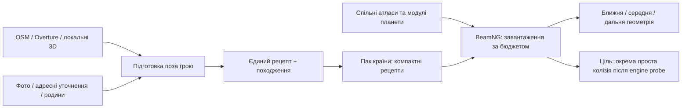

# Building Grammar: як зробити місто впізнаваним

Для EarthNG я пропоную **поєднати реальну геометрію будинків із невеликою бібліотекою узгоджених архітектурних родин**, а складне зіставлення даних виконувати до запуску гри. Контур, висота, частини, дах і проїзди визначають конкретне місце; родина додає характерні вікна, лоджії, перший поверх і палітру там, де точних відомостей бракує. BeamNG отримує вже підготовлений компактний рецепт і спільні матеріали. Це дозволяє нарощувати різноманіття без окремої моделі й великої текстури для кожної адреси. Найбільший очікуваний виграш — правильний силует та ритм фасаду, які залишаються сталими на різних відстанях. Нижче — концепція для майбутньої переробки, а не опис уже реалізованої системи чи виміряний прогноз продуктивності. Джерела й стан коду перевірено 19 жовтня 2026 року.

**Інтернет дає різні шари достовірності, які важливо не змішувати.**

Контур, висота і зовнішність — три окремі задачі. Глобальна база контурів не означає, що для кожного будинку відомі поверховість, форма даху чи фасад. Для Києва практична стартова комбінація — OSM та Overture, доповнені вибірковими фотографіями й локальними описами. Перед розширенням імпорту потрібен невеликий аудит фактичної заповненості цих даних у наших районах.

| Джерело | Що можна отримати | Покриття та межі достовірності | Роль в EarthNG |
|---|---|---|---|
| [OSM Simple 3D Buildings](https://wiki.openstreetmap.org/wiki/S3DB) | Контури, частини, висота, поверхи, нижня межа об'єму, параметри даху; іноді матеріал і колір | Теги заповнюються нерівномірно. Явна висота та висота, виведена з поверхів, мають різне походження | Основа конкретної будівлі, особливо складних об'ємів |
| [Overture Buildings](https://docs.overturemaps.org/guides/buildings/) | Нормалізовані контури, частини, атрибути та походження | Глобальний шар. Висоти, поверхи, roof/facade-поля у [схемі](https://docs.overturemaps.org/schema/reference/buildings/building/) необов'язкові; це не гарантія заповнення у Києві | Базовий набір і заповнення прогалин |
| [Microsoft GlobalMLBuildingFootprints](https://github.com/microsoft/GlobalMLBuildingFootprints) | Контури з машинного розпізнавання; місцями оцінені висоти | Висота — передбачення моделі, не вимір карниза. Конкретне покриття українських висот тут не підтверджено | Додаткові контури, часто вже включені до Overture |
| [Google Open Buildings](https://sites.research.google/gr/open-buildings/) | Контури та оцінка впевненості розпізнавання | Україна не входить до покриття. Немає опису фасаду | Варіант для майбутніх регіонів, не джерело для Києва |
| [GHSL GHS-BUILT-H](https://human-settlement.emergency.copernicus.eu/ghs_buH2023.php) | Оцінена середня висота забудови клітинки | Глобальний шар 100 м, епоха 2018. Не висота окремої адреси | Районний розподіл висот і перевірка грубих аномалій |
| [3DBAG](https://docs.3dbag.nl/en/) та локальні міські 3D-набори | Детальніші об'єми й дахи, зокрема LoD2 | 3DBAG охоплює Нідерланди; доступність інших наборів залежить від місця | Точний локальний замінник процедурної геометрії |
| [Wikidata](https://www.wikidata.org/wiki/Property:P149), [Commons](https://commons.wikimedia.org/wiki/Commons:Reusing_content_outside_Wikimedia/licenses), [Mapillary](https://www.mapillary.com/developer/api-documentation/) | Стиль, дати, фотографії та візуальні ознаки | Вибіркове покриття; фотографію ще треба правильно прив'язати до будинку й часу | Перевірка родин, адресні уточнення, орієнтири маршруту |

Повного відкритого завантажуваного LoD2 для Києва в цьому дослідженні не підтверджено. [Міський портал](https://data.kyivcity.gov.ua/) є, але наявність переліків нерухомості не означає наявності готової тривимірної геометрії. CityJSON і CityGML варто передбачити як формати імпорту локальних наборів; вони самі не є джерелом даних.

Фотографії найкорисніші для **виділення повторюваних ознак**: пропорцій вікон, кроку секцій, типу лоджій, кольорів, оформлення першого поверху. Спершу достатньо перевіреної вибірки будинків, із якої створюється кілька авторських фасадних наборів. Автоматичне розпізнавання можна додавати поступово, з контролем прив'язки камери й датування. Результат без адресного підтвердження залишається стилізацією: фотографія сусідньої панельки не доводить вигляд цієї панельки.

Умови джерел слід зберігати разом із версією набору. OSM і Overture Buildings використовують ODbL; прямий Microsoft нині вказує CDLA Permissive 2.0, тому його умови не можна автоматично переносити на збірку Overture. Wikidata — CC0 для структурованих даних; ліцензію фото Commons перевіряють окремо. Для Mapillary діють умови використання знімків і похідних метаданих. Відкритість контурів не дає дозволу брати текстури з Google Maps. Це аргумент на користь власних спільних атласів та чіткого маніфесту джерел. ([OSM](https://www.openstreetmap.org/copyright), [Overture](https://docs.overturemaps.org/attribution/), [Microsoft LICENSE](https://github.com/microsoft/GlobalMLBuildingFootprints/blob/main/LICENSE), [Wikidata](https://www.wikidata.org/wiki/Wikidata:Licensing), [Mapillary metadata](https://help.mapillary.com/hc/en-us/articles/115001777705-OpenStreetMap-compatibility))

**Один будинок потребує одного запису, але окремого походження кожного поля.**

Не варто просто накласти OSM, Overture і Microsoft як три шари: Overture вже об'єднує джерела, надає OSM пріоритет і додає неперекриті будівлі. Повторний імпорт Microsoft може повторно додати той самий об'єкт. Спочатку потрібне зіставлення за ідентифікаторами, перекриттям, положенням, орієнтацією та площею; суперечливі випадки «один корпус проти кількох секцій» мають залишатися явними. Супутниковий контур також може описувати дах, зміщений відносно стін через кут знімка. Його не можна безумовно підставляти замість наземного контуру. ([Overture guide](https://docs.overturemaps.org/guides/buildings/), [Google FAQ](https://sites.research.google/gr/open-buildings/))

Пропонований пріоритет застосовується **до властивості**, а не до джерела загалом: перевірене адресне уточнення; надійне локальне вимірювання або явний картографічний тег; атрибут з відомим походженням у зведеній базі; оцінка з поверховості; районне припущення. Новіші дані не завжди точніші, тому потрібні дата спостереження й правила вибору стану міста. Контур може бути достовірний, дах невідомий, висота оцінена, а фасад цілком синтетичний — один загальний «confidence будинку» приховав би це.

| Частина канонічного рецепта | Що зберігаємо |
|---|---|
| Ідентичність | Власний стабільний ID, посилання на source IDs, версія рецепта |
| Фактична форма | Контур із отворами, частини, нижня й верхня висоти, поверхи, дах |
| Семантика | Використання, архітектурна родина, вуличні/дворові фасади, спільні стіни, відомі входи й проїзди |
| Оформлення | Розкладка секцій і вікон, варіанти атласу, палітра, дозволені великі деталі |
| Походження | Для поля: source, дата, метод, статус `mapped / measured / inferred / styled`, причина fallback |
| Відтворюваність | Стабільний seed для властивостей; версія граматики в ключі кешу |

Повний журнал походження залишається в базі підготовки; у країновому паку достатньо компактних індексів на маніфест. Seed має залежати від canonical ID та назви властивості, а не порядку завантаження або номера тайла. Заміна атласу тоді не пересуває входи, а перемикання деталізації не змінює дах.

Нормалізація висот теж потребує семантики. В OSM `height` включає дах, а `min_height` задає нижню межу: `height=13`, `min_height=10` означає триметровий об'єм над проходом. За повного набору частин не слід додатково заповнювати весь батьківський контур суцільною коробкою. Нинішній експортер EarthNG підставляє поверхи × 3 або 9 м за відсутності висоти; майбутній формат має явно зберегти статус такої оцінки. ([OSM S3DB](https://wiki.openstreetmap.org/wiki/S3DB), [build_country.py](C:/js/EarthNG/earthng/build_country.py:195))

**Різноманіття має виникати із сумісних родин, а впізнаваність — із правильних обмежень.**

Граматика — це послідовність рішень: будинок ділиться на об'єми, об'єм на фасади й дах, фасад на перший поверх, повторювані поверхи та завершення, поверхи — на віконні модулі й простінки. Саме такий ієрархічний поділ демонструє [офіційний приклад CityEngine](https://doc.arcgis.com/en/cityengine/latest/tutorials/tutorial-6-basic-shape-grammar.htm). Нам потрібна ця ідея, реалізована простими власними правилами для нативних мешів BeamNG.

Родина зв'язує параметри: панельні шви узгоджуються із секціями, лоджії складаються у вертикалі, карниз відповідає типу будинку. Вікна займають цілу кількість модулів; залишок ширини розподіляється в простінки, а не розтягує останнє вікно. Варіації ремонту краще задавати для секції, скління — для квартири. Незалежний випадковий колір кожного вікна дасть візуальний шум. Район задає очікувану суміш родин, але конкретні дані мають її перевизначати.

| Приклад | Що робить його впізнаваним | Як відтворити ощадливо |
|---|---|---|
| Київський панельний блок | Реальний довгий чи ламаний контур, поверховість, ритм секцій, вертикалі лоджій, торці | Спільний атлас панелей і вікон; великі лоджії геометрією поруч; локальні варіанти скління. Без доказів не присвоювати конкретну типову серію |
| Історичний будинок Подолу | Контур кварталу, висота, карниз, дах, арка, парадний і дворовий фасади | Геометричні арки та великі еркери; текстурний дрібний декор; простіші дворові фасади. Торговий низ лише за обґрунтованого припущення |
| Приватний будинок | Пропорції об'єму, прибудови, дах, ґанок, положення на рельєфі | Кілька узгоджених родин дахів і прорізів; кладка й рами в атласі. Паркани та сад залишаються окремою системою ділянки |

Поділ не має ставати одним «історичним пресетом»: там є різні епохи й сучасні вставки. Міський опис підтверджує змішаність забудови, а не єдиний стиль кожної адреси. ([Науково-проєктна документація «Стародавній Київ»](https://kyivcity.gov.ua/npa/pro_zatverdzhennya_naukovo-proyektno_dokumentatsi_plan_organizatsi_teritori_derzhavnogo_istoriko-arkhitekturnogo_zapovidnika_starodavniy_kiv/yarmtq3nhf_tekstova_chastina.pdf))

Використання будинку теж потрібно відокремити від архітектури: готель у старій кам'яниці не перетворюється на скляний офіс. Вуличний фасад, двір, відкритий торець і стіна впритул до сусіда отримують різні правила; кутовий будинок може мати два парадні фасади. Пам'ятки й ключові орієнтири маршруту доцільно робити адресними моделями поверх загальної системи.

[Stratum](https://github.com/SamG-Coder/stratum) корисний як приклад параметричного опису, кешу й деталізації. Але це прототип із власним CUDA/WebGPU-рендерером; MIT-ліцензія його нового коду не робить його готовим компонентом BeamNG. Для знайденого [RealisticCity](https://github.com/SamG-Coder/RealisticCity) дозвіл на повторне використання нового application-коду не підтверджений. Базувати нашу систему на їхньому рендерері або обіцяній швидкості немає підстав.

**BeamNG має отримувати просту роботу під час їзди.**

До гри виносимо злиття джерел, визначення фасадів і сусідів, класифікацію родин, розв'язання складних дахів як параметричного опису та зіставлення фотографій. Пак країни містить компактні рецепти, без готових мешів. У грі залишаються читання рецепта, просте розгортання, видимість і керування бюджетом. Якщо вводимо кеш похідних мешів, він локальний, має версію й може бути видалений та перебудований; його не поширюємо всередині країнового паку. Це розвиває вже зафіксоване розділення «країна — факти, планета — правила й ресурси, runtime — показ». ([Реєстр прогалин](C:/js/EarthNG/docs/GENERATION_GAPS.md:15))

Геометрія потрібна там, де змінюється силует, велика тінь або доступний прохід: дах, еркер, арка, значна лоджія. Цегла, панельні шви, більшість рам і дрібний декор переходять в атласи — спільні текстури, з яких різні будинки вибирають потрібні ділянки. Це відповідає [рекомендаціям BeamNG](https://documentation.beamng.com/modding/levels/level_creation/section8/). Атлас потребує перевірки повторення, відступів і mipmaps, щоб сусідні фрагменти не просочувалися на фасад здалеку.

У нас уже є пакетування ProceduralMesh, але історичні заміри вказують, що дорогими бувають створення меша, перша поява пари «об'єкт–матеріал», збірка сміття й перебудова колізії. Це означає, що тисячі окремих вікон-об'єктів можуть програти навіть за малої кількості полігонів. Нинішні шматки до 2500 трикутників — існуюче обмеження, а не універсальний оптимум; новий розмір просторових пакетів треба перевірити. ([Локальні заміри](C:/js/EarthNG/docs/PERFORMANCE.md:19), [пакетування](C:/js/EarthNG/mod/lua/ge/extensions/e2r/generator.lua:477))

Доцільні два виходи спільного рецепта: ProceduralMesh для масових довільних контурів і підготовлені DAE/TSStatic для повторюваних складних форм та орієнтирів. TSStatic має документовані LOD, окрему колізію та режим без неї; автоматично приписувати ці можливості ProceduralMesh не можна. Так само prefab спрощує авторство, але не гарантує один draw call. ([TSStatic](https://documentation.beamng.com/modding/levels/level_classes/tsstatic/), [модульні будівлі](https://documentation.beamng.com/modding/levels/level_creation/section5/))

Усі рівні деталізації мають показувати **той самий будинок**: здалеку зникають виступи й декор, але залишаються орієнтація, висота, дах, основна палітра та значні порожнини. Зараз далекий рівень замінює контур осьовою рамкою та плоским дахом; це перевірена слабкість для майбутньої переробки. ([Поточна геометрія](C:/js/EarthNG/mod/lua/ge/extensions/e2r/generator.lua:2108))

Колізія зберігає стіни й доступні машині проходи, без дрібного декору. Арку не можна намалювати на суцільній колізійній стіні. Для ProceduralMesh нинішній механізм виключення декорацій із колізії працює на рівні об'єкта, тому декоративні та колізійні поверхні треба розділяти вже при пакетуванні. Нові способи окремих невидимих колайдерів потребують engine probe. ([Поточний collision pipeline](C:/js/EarthNG/mod/lua/ge/extensions/e2r/collision.lua:1))

**Перший пілот має перевірити впізнаваність раніше, ніж розростеться бібліотека.**

Пропоную три ділянки: панельний квартал, історичну забудову з двором/аркою та приватні будинки на рельєфі. Орієнтовно 100–200 будівель, із ручною перевіркою 20–30 адрес, достатньо для початкового інженерного експерименту; це запропонований обсяг, не статистична гарантія. Початковий набір — 4–6 родин із небагатьма узгодженими підтипами.

Спочатку вимірюємо заповненість джерел та фіксуємо правильні контури, висоти й дахи. Потім порівнюємо поточний генератор із граматикою на однакових маршрутах і камерах. Оцінюємо окремо впізнавання типу забудови, характеру кварталу й конкретних адрес; перевіряємо поверховість, проходи та стабільність силуету між LOD. Накладка походження даних корисна для цього аудиту, але не потрібна постійно під час гри.

Продуктивність перевіряємо на тому самому ПК, машині й налаштуваннях у кількох повторних проїздах: усталений час кадру, p95/p99, довгі кадри під час появи кварталу, створення мешів, нові пари об'єкт–матеріал, GC, колізія, пам'ять і розмір паків. Початкова ціль — не збільшити число таких пар завдяки спільним атласам; допустиму зміну часу кадру встановлюємо після базового заміру. Наразі це критерії експерименту, **нових вимірювань у грі не виконано**.

Найцінніше рішення зараз — домовитися про канонічний рецепт і межу між фактом та припущенням. Тоді нове джерело поліпшує конкретні будинки без переписування рендерера, а новий фасадний набір додає різноманіття без втрати їхньої ідентичності. Саме це зробить Building Grammar довготривалою основою переробки, а перший пілот покаже, які кілька ознак найбільше повертають відчуття нашого міста.
